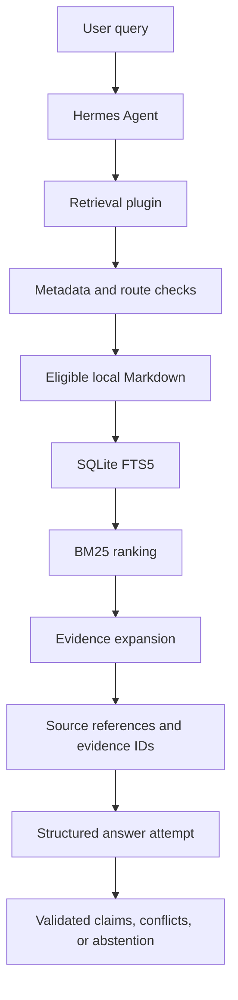

# Hermes Obsidian Retrieval

**Privacy-aware local knowledge retrieval for Hermes Agent.**

> **Experimental v0.2.2 — Development frozen.** Retrieval functionality is implemented and benchmarked, but end-to-end answer quality has not passed acceptance testing. The plugin remains disabled in its original environment.

Independent experimental integration; not an official Hermes Agent, Nous Research, or Obsidian product.

[Quickstart](#quickstart) · [Architecture](#architecture) · [Privacy](#privacy-and-security) · [Benchmarks](#benchmark-results) · [Validation](docs/validation.md) · [Status](STATUS.md) · [Changelog](CHANGELOG.md) · [License](LICENSE)

Hermes Obsidian Retrieval explores how an AI assistant can find relevant material in a local Obsidian knowledge base without repeatedly copying whole documents into the conversation. It combines metadata-gated Markdown indexing with SQLite FTS5/BM25 search and source references. Its answer-generation path is experimental and remains unaccepted.

## Why

Personal knowledge bases can contain useful research and project context, but sending whole notes to a model is inefficient and creates information-governance risks. This project tests a small local retrieval layer for Hermes Agent: search eligible notes, return relevant source sections, and attempt to structure answers around traceable evidence.

## Features

- **Local lexical retrieval** — SQLite FTS5 indexes eligible Markdown headings and text; BM25 ranks results.
- **Metadata gate** — indexing requires explicit frontmatter values rather than assuming every vault note is shareable.
- **Incremental refresh and revocation** — changed notes are refreshed and notes that lose eligibility are removed from the local index.
- **Evidence expansion** — selected headings can be expanded under an approximate token budget.
- **Structured answer attempt** — the plugin validates evidence IDs and exact source quotes, and represents missing information and conflicts.
- **Bounded tests and benchmark** — unit tests and a retrieval-only comparison harness are included; private benchmark inputs and detailed rows are not.

Retrieval performance and answer correctness are distinct. The retrieval path is benchmarked; the end-to-end answer-generation path has not passed acceptance.

## Quickstart

This archive is a Hermes plugin source tree, not a standalone pip package. The tests can be run without connecting a vault or model:

```bash
git clone https://github.com/Atabak-Nikouseresht/hermes-obsidian-retrieval.git
cd hermes-obsidian-retrieval
python -m unittest discover -s tests -v
```

If Hermes Agent is installed, validate the plugin from the repository root without enabling it:

```bash
hermes plugins validate . --json
hermes plugins doctor . --ci
```

The plugin was not accepted for production use. Do not point it at real personal notes or enable it on the basis of these checks alone. See [`docs/validation.md`](docs/validation.md) before any evaluation.

## Minimal synthetic example

For a disposable synthetic vault, the relevant plugin settings can be represented as:

```yaml
vault_path: "C:/path/to/synthetic-vault"
allow_remote_transmission: false
evidence_token_budget: 6000
```

`C:/path/to/synthetic-vault` is a fictional placeholder. Use a temporary vault containing synthetic notes only; do not point this example at a personal vault.

A hypothetical note can be made eligible for local indexing with explicit frontmatter:

```markdown
---
ai_index: true
confidentiality: public
---
# Example Research Project

## Objective

Evaluate a synthetic research dataset using documented statistical methods.
```

Example question: **“What is the objective of the example research project?”**

An illustrative `personal_os_search` result identifies a vault-relative source path, heading, excerpt, and evidence ID, for example:

```json
{
  "success": true,
  "results": [
    {
      "vault_relative_path": "Example Research Project.md",
      "heading": "Objective",
      "evidence_id": "ev_<source-derived-id>",
      "excerpt": "Evaluate a synthetic research dataset using documented statistical methods."
    }
  ]
}
```

This is a **format illustration only**; the placeholder ID is not a captured run and this example is not evidence of successful Hermes-session integration.

## Architecture



The diagram describes the implemented request path, not a claim that every stage has passed end-to-end acceptance. See [`docs/architecture.md`](docs/architecture.md) for the index schema, refresh and revocation behavior, answer-call path, and route checks.

## Technology

| Technology | Role |
|---|---|
| Python and Hermes plugin API | Tool registration, indexing logic, and structured answer integration |
| SQLite FTS5 | Local full-text index without a separate indexing service |
| BM25 | Lexical relevance ranking over title, heading, and body fields |
| Markdown and frontmatter | Note structure and explicit eligibility metadata |
| Python `unittest` | Fast regression tests for indexing, privacy gates, and answer validation |

No embeddings, vector database, or additional application framework is included.

## Privacy and security

- A note is locally indexable only when `ai_index: true` is the exact boolean and `confidentiality` is `personal` or `public`. Missing, false, quoted-string, `private`, and `highly_private` values are denied.
- Hidden paths, templates, attachments, trash, `.obsidian`, symlinks, and non-Markdown files are excluded. Links and embeds are not followed or transcluded.
- `ai_index: true` **does not authorize remote transmission**. Remote transmission defaults to disabled; if explicitly enabled, a note also needs the exact boolean `ai_remote_share: true`.
- The plugin treats only loopback routes as local. Unknown/remote routes fail closed unless remote transmission is separately enabled; remote retrieval remains gated per note. Keep model fallback routes under review.
- The index is stored under Hermes plugin data, not in the vault or this repository. Directory permissions and SQLite/FTS secure-delete behavior are used, but the index has **no application-layer encryption** and cleanup is not a forensic-erasure guarantee.
- Exact quote matching confirms that a quote occurs in the source; it does not prove semantic entailment.

Do not use the plugin with private notes and a remote provider unless you have separately reviewed and approved the data flow. The original staged plugin remains disabled.

## Benchmark results

### Retrieval-only comparison

The historical evaluation used **28 questions** and **71 eligible notes**. The original questions and detailed per-question result rows are excluded because they contain personal-topic prompts and private source-note references.

| Metric | SQLite FTS5/BM25 | Title/heading scan baseline |
|---|---:|---:|
| Recall@5 | 0.9464 | 0.6429 |
| MRR | 0.8839 | 0.6726 |
| Top-1 source accuracy | 0.7857 | 0.6429 |
| Source precision@5 | 0.2773 | 0.1901 |

These results show stronger retrieval metrics against this particular baseline, not answer faithfulness. Mean latency was higher for FTS5/BM25 in both recorded comparisons: an earlier report recorded **48.456 ms vs 46.410 ms**, while the later saved aggregate recorded **46.261 ms vs 44.639 ms**. The later saved p95 values were **52.667 ms vs 48.198 ms**. The benchmark did not call a model or generate answers.

### Answer-generation evaluation

The last complete historical evaluation, before the final 0.2.2 hardening, tested 20 questions:

- Retrieval-based answers were nonempty/parseable in **17/20** cases.
- Expected-source citation linkage was **51.6%**.
- Missing-information handling was correct in **0/4** cases.
- Broad contradiction handling failed.

These are historical, automated acceptance results, not a human semantic-faithfulness review. Final 0.2.2 changes did not complete a full post-fix answer-quality benchmark or fully verified Hermes-session integration. The complete evidence boundary is in [`docs/validation.md`](docs/validation.md).

## Testing and development

Run the unit suite with Python 3.11 or a compatible Hermes Python environment:

```bash
python -m unittest discover -s tests -v
python -m py_compile __init__.py personal_os_retrieval/answering.py personal_os_retrieval/indexer.py
```

The recorded archive verification had **35 passing unit tests**, **13 passing Hermes plugin validation checks**, and a passing Hermes plugin doctor check. Hermes-specific checks require Hermes Agent; the unit suite does not call a model. No standalone packaging metadata or install command is provided.

The benchmark harness expects a local `benchmarks/questions.json`, intentionally absent from Git. See [`benchmarks/README.md`](benchmarks/README.md); do not recreate or publish the private evaluation fixture.

## Project structure

```text
hermes-obsidian-retrieval/
├── .gitignore
├── README.md
├── CHANGELOG.md
├── STATUS.md
├── PROJECT_MANIFEST.md
├── LICENSE
├── plugin.yaml
├── __init__.py
├── personal_os_retrieval/
│   ├── answering.py
│   └── indexer.py
├── tests/
│   ├── test_answering.py
│   ├── test_expansion.py
│   ├── test_indexer.py
│   └── test_plugin.py
├── benchmarks/
│   ├── README.md
│   └── run_benchmark.py
└── docs/
    ├── architecture.md
    └── validation.md
```

## Limitations and status

- **Experimental; development frozen; not production-ready.**
- Full post-fix answer-quality acceptance, human-reviewed claim support, and complete current Hermes-session integration are not verified.
- Prior missing-information and contradiction results failed acceptance.
- The real-vault sensitivity classification and remote suitability of personal notes are not approved.
- The index is not encrypted at the application layer.

See [`STATUS.md`](STATUS.md) for the formal freeze and [`docs/validation.md`](docs/validation.md) for verified, failed, and unverified results.

## License

Licensed under the MIT License. See [`LICENSE`](LICENSE).

## Author

**Atabak Nikouseresht** — MSc Applied Economics and Markets, University of Bologna. Professional interests include financial risk, data analytics, applied economics, AI automation, digital finance, and data engineering.

[GitHub profile](https://github.com/Atabak-Nikouseresht)
