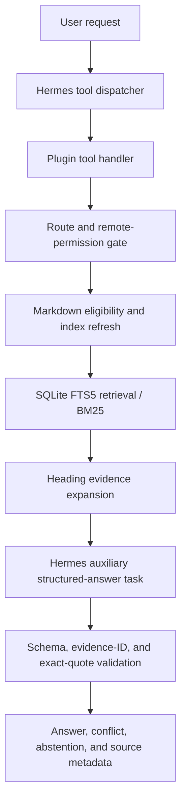

# Architecture

This document describes the version 0.2.2 source preserved in this repository; it is not an assurance of production readiness.

## Components and request flow

### Entry point and registration

`__init__.py` registers two tools in the `personal_os_retrieval` toolset: `personal_os_search` and `personal_os_answer`. It also registers the `pre_api_request` hook and the `personal_os_retrieval_answer` auxiliary task. The hook records only a loopback/non-loopback boolean keyed to the Hermes home and session, with a 30-minute TTL and a bounded in-memory entry count; it does not retain the endpoint or request payload.

### Eligibility and parsing

`personal_os_retrieval/indexer.py` walks Markdown files under the configured vault root. It excludes hidden paths, symlinks, template names/folders, `.obsidian`, `.trash`, attachment folders, non-Markdown files, and notes larger than 8 MiB. It parses simple scalar frontmatter rather than general YAML. A note is eligible only when `ai_index` is the exact boolean `true` and `confidentiality` is `personal` or `public`. Quoted strings, missing values, `false`, `private`, and `highly_private` do not pass. Remote eligibility adds a separate exact boolean `ai_remote_share: true`.

Markdown is divided at headings and into bounded text pieces. Embedded files are removed from searchable text; wikilinks and attachments are not followed. Eligible note bytes are SHA-256 hashed so updates and evidence identifiers can be tied to a particular note version.

### Index lifecycle and schema

`LocalIndex` stores the index under Hermes plugin data (not in the vault or repository):

- `notes`: vault-relative path, raw-note SHA-256, modification time, UTC modified value, and `knowledge_status`.
- `chunks`: row id, path, title, heading, and section body.
- `chunks_fts`: an FTS5 external-content virtual table over title, heading, and body, maintained by insert/update/delete triggers.

Refresh scans eligible files, updates changed hashes, and removes no-longer-eligible notes and chunks. Search rechecks current metadata and the current source hash before returning results. Folder filters reject traversal. FTS5 is queried with BM25 weights of 8 for title, 4 for heading, and 1 for body. A simpler direct scan can rank indexed note sections when FTS results are weak.

### Evidence and answer generation

Search returns source path/relative path, heading, evidence ID, excerpt, modification metadata, knowledge status, and score. An evidence ID is `ev_` plus a truncated SHA-256 over the vault-relative path, heading, and raw-note digest. The answer path expands matching headings from the current note after rechecking path containment, eligibility, and source hash; text is capped by a tokenizer-independent approximate budget. If FTS evidence is weak, a direct-note top result may be expanded across its headings under a shared budget.

`_answer_handler` calls `ctx.llm.complete_structured` with the answer schema, temperature 0, a 1,200-token output cap, a 180-second timeout, and the `personal_os_retrieval_answer` task. The schema distinguishes confirmed facts and inferences and includes claims, conflicts, and missing information. `answering.py` removes claims unless each has a known evidence ID and an exact substring quote from that evidence. It does not verify semantic entailment. Invalid structured output or invalid citations can trigger one bounded regeneration attempt; if no supported claim remains, the result abstains.

The current Hermes-session path is not fully verified after the final 0.2.2 changes. See [`validation.md`](validation.md).

### Routing and remote restrictions

The plugin treats only `localhost` or an IP loopback URL as local. Missing/expired route state is not local. Remote transmission is denied unless `allow_remote_transmission` is explicitly true. If a session or auxiliary task is treated as remote, retrieval is restricted to notes with the separate `ai_remote_share: true` permission. The auxiliary task's provider and fallback configuration are checked; configured fallback providers/models/chains cause the task to fail closed as non-local. Route checks are an application control, not a guarantee against all external routing or configuration errors.

### Storage hardening, revocation, and errors

`secure_data_dir` applies a restricted Windows ACL (current account, SYSTEM, and Administrators) or owner-only POSIX mode to the dedicated index directory. SQLite secure-delete and FTS5 secure-delete are enabled. When notes are revoked or removed, the plugin checkpoints/truncates the WAL and vacuums the database, refusing retrieval if cleanup remains busy. These measures do not encrypt the database and do not promise forensic erasure.

Tool handlers return bounded JSON errors rather than raw exception text. Index and evidence operations fail closed when paths, metadata, route status, or refreshed hashes cannot be verified. The vault is read-only from the plugin's perspective; index data is kept in Hermes plugin-data.
